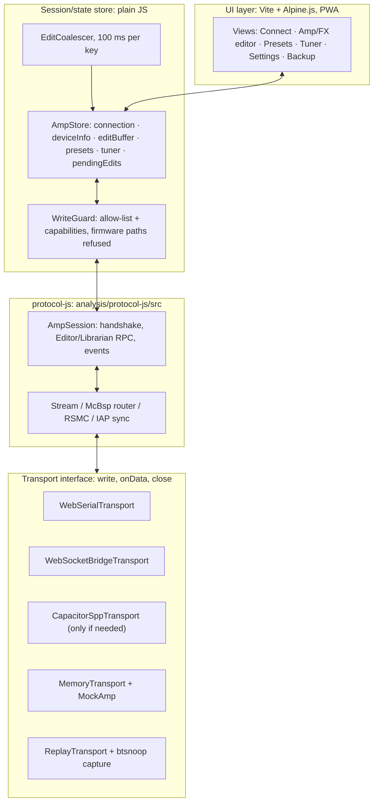

# ReAmpliFi: plan for a custom AMPLIFi 150 control app

Scope: **settings and presets only.** Firmware update, flash, DFU and the updater service are **out of scope, permanently**, and the code refuses them (section 5.8).

Inputs:
- the static analysis in `INVENTORY.md`, `notes/java_side.md`, `notes/native_transport.md`, `notes/native_messages.md`;
- `PROTOCOL.md`, `FINDINGS.md` and `protocol-js/` (in progress, written by other agents; this plan references them and does not change them);
- web research done on 2026-10-26. Every source has a URL and is marked:
  - **[docs]**: verified from an official document or announcement;
  - **[report]**: community or forum report;
  - **[belief]**: my own understanding, not verified for this plan.

---------------------------------------------------------------------------------------------------

## 1. Constraints from the analysis

### 1.1 Certain (read in code)

| Topic | Fact | Source |
|---|---|---|
| Radio | **Classic Bluetooth RFCOMM / SPP**, UUID `00001101-0000-1000-8000-00805f9b34fb`. No BLE, no USB, no Wi-Fi. The amp must be paired at OS level first. The official app uses *insecure* RFCOMM. | INVENTORY §5, java_side §1.3 |
| Security | **No encryption, no authentication.** The "handshake" is a CRC-32 compatibility check of the symbol table. | transport §9, messages §0.7 |
| Layer 1 | ASCII link sync: the client writes `IAP x OK`, then `IAP x START` (~1 s later). On close: `IAP x STOP`. Received data is never parsed as ASCII. | transport §2 |
| Layer 2 | RobustSerial (RSMC) frames: `55 55`, seq/ack/credit, len, payload CRC16 and header CRC16 (CCITT-FALSE, little-endian). Window of 8, retransmit after 1000 ms, a header-only keepalive frame every 200 ms. MTU 240 or 256. | transport §3 |
| Layer 3 | McBsp router with an 8-byte header and 16-bit addresses. Editor = `0x2002↔0x03ED`, Librarian / DeviceInfo = `0x2003↔0x03EF`. | transport §4 |
| Layer 4 | TCP-like streams: SYN/FIN/DATA/WND/HB flags. Per-segment seq must be exactly +1, otherwise the stream aborts. Heartbeat. | transport §5 |
| Layer 5 | RPC: requests are `u32 cmd, u32 len, payload`; responses and events are `u32 type, u32 len, body`. Responses are matched **FIFO** (no transaction id). | transport §6 |
| Addressing | Params are `(slotIndex, paramIndex)` = **0-based indexes in the symbol table**. Values are `TypedValue {tag, bits}`; knobs are float32 in model units. | messages §0, §2 |
| Presets | Select, save, model change and tone load all use a **binary preset blob** over the Librarian: `GetPresetFile`(11) and `SetPresetFile`(12), with index `0xFFFFFFFF` = edit buffer. Preset select = read slot N, then write it to the edit buffer. | messages §4 |
| Events | The amp pushes patch, param, tap-tempo and FBV events without being asked. The tuner needs `RegisterDspEvent`. | messages §6, §7 |
| Official app pacing | Edits are coalesced per key, with **≥100 ms** between commands (`CommandRestrictingHandler`). | java_side §1.6 |
| Throughput | At most about 1 RSMC data frame per 200 ms, so roughly 1.2 KB/s. Reading one ~1.2 KB preset blob takes about 1 s. | transport §3.3 (INFERRED from the timers) |

### 1.2 Unknown (needs the amp)

| # | Question | Why it matters |
|---|---|---|
| U1 | Does the amp **require** the `IAP x …` strings? Does it answer them? | The connect sequence |
| U2 | Does the amp accept the bundled symbol-table CRC `0xB68B291E`, or does it force a download (cmd 2/3)? | All param indexes depend on the table the amp accepts |
| U3 | The amp's heartbeat timeout and MSS. We assume a client heartbeat ≤ 1 s is safe. | Link stability |
| U4 | How the firmware version is packed (is `0x02100100` = 2.10.1?), which decides MTU 240/T 16 s vs MTU 256/T 4 s | Link parameters |
| U5 | Are preset blobs byte-exact? (state order, checksums, UUID needs) | **Preset safety** |
| U6 | Units and range of `Master` / `GuitOutputGain` (0..1 INFERRED) | First live write |
| U7 | The current preset index after connect: no query exists; it is known only from patch events | UI state |
| U8 | Amp semantics of `MovePresetFiles` (argument order, insert vs swap) and of `LoadHardwarePreset` (13) | P4 |
| U9 | Whether the amp ever interleaves events inside responses, or reorders responses | FIFO matching |
| U10 | Whether the amp accepts more than one SPP client, and how it behaves while A2DP audio is connected | Practical use |

---------------------------------------------------------------------------------------------------

## 2. Platform recommendation

### 2.1 Verified facts (research, 2026-10-26)

**Desktop: Web Serial can talk to paired Bluetooth Classic RFCOMM devices.**
- Chrome supports this since **Chrome 117 on desktop**. It works only with devices that are **already paired** with the system. **[docs]**
  - <https://developer.chrome.com/blog/serial-over-bluetooth> (last updated 2023-10-13)
  - intent to ship, 2023-07-25: <https://groups.google.com/a/chromium.org/g/blink-dev/c/P4YwDCcvdvs/m/CHbyTu_gAAAJ>
- SPP UUID `0x1101` is the one SIG UUID that is *not* blocked. Custom RFCOMM services need `allowedBluetoothServiceClassIds`. A `filters: [{ bluetoothServiceClassId }]` entry narrows the picker. `port.getInfo().bluetoothServiceClassId` reports the service. **[docs]**, same blog.
- Chrome "can now communicate with the serial interface even if the operating system has not created a device node". In other words, **Chrome does not depend on `/dev/cu.*` or COM ports for this.** **[docs]**, same blog.
- Since **Chrome 130 (desktop)**, `SerialPort.connected` and connect/disconnect events work for RFCOMM ports. Also: an opened wireless port **closes automatically** when the device goes out of range. **[docs]**
  - <https://developer.chrome.com/blog/bluetooth-rfcomm-updates-web-serial> (2024-09-16)
  - intent to ship, M129/130: <https://groups.google.com/a/chromium.org/g/blink-dev/c/KPN62vo5Pp4/m/DwXN907wAgAJ>
- Web Serial itself has shipped on desktop Chrome and Edge since 89, on ChromeOS, Linux, macOS and Windows. **[docs]** <https://developer.chrome.com/docs/capabilities/serial>
  - MDN lists `allowedBluetoothServiceClassIds` as Chrome/Edge 117+. **[docs]** <https://developer.mozilla.org/docs/Web/API/Serial/requestPort>
  - caniuse (accessed 2026-10-26) lists Firefox 151+ as supported, and Safari / iOS Safari as **not supported**. I did not check Bluetooth RFCOMM support in Firefox. <https://caniuse.com/web-serial>

**Android: Chrome has Web Serial over Bluetooth RFCOMM. This contradicts the "we need Capacitor for Android" assumption.**
- **Chrome 138 for Android** (stable 2025-06-24) shipped "Web serial over Bluetooth on Android". **[docs]**
  - <https://developer.chrome.com/release-notes/138>
  - intent to ship, 2025-04-24: <https://groups.google.com/a/chromium.org/g/blink-dev/c/BqUGCcurReE/m/XbuAYkRxEQAJ>
- **Chrome 148** (stable 2026-05-05) added general Web Serial on Android (USB as well). **[docs]** <https://developer.chrome.com/release-notes/148>
- Caveats from the Android intent:
  - `connected` and connect/disconnect events are **not fully supported** on Android over Bluetooth;
  - **Android WebView does not get Web Serial**, so a Capacitor or Cordova app cannot use `navigator.serial` and needs a native plugin.
  - **[docs]**, same intent.

**iOS: no path.**
- The External Accessory framework works only with MFi-licensed accessories. Core Bluetooth is BLE-only. The amp's SPP is not MFi. **[docs]** Apple QA1657: <https://developer.apple.com/library/content/qa/qa1657/_index.html>
  - An Apple engineer said the same in the forums **[report]**: <https://developer.apple.com/forums/thread/91997>
- No iOS browser has Web Serial **[docs]**, caniuse above.
- **The only iOS route is a bridge** (section 2.4).

**OS serial-port mapping (fallback route, not needed by Chrome):**
- **macOS** creates `/dev/cu.<DeviceName>` for paired SPP devices **[belief]**. Reports of quirks:
  - the port opens after a reconnect but no data flows until `bluetoothd` is restarted (`sudo pkill bluetoothd`) **[report]**: <https://community.st.com/t5/others-stm32-mcus-related/rn4678-macos-rfcomm-spp-reconnect-port-opens-but-no-data-until/td-p/838349>
  - since Monterey the name has no `-DevB` suffix, and reconnects needed re-pairing **[report]**: <https://discourse.processing.org/t/macos-monterey-wont-reconnect-to-hc-05-bluetooth-without-removing-re-pairing-each-time/38119>
  - an M2 Mac sees `/dev/cu.*`, but `screen` hangs **[report]**: <https://forum.arduino.cc/t/how-to-use-hc05-with-macbook-pro-m2/1168000>
  - I found nothing specific to Sonoma, Sequoia or Tahoe.
  - The RFCOMM channel is opened when the port is opened, not at pairing **[belief]**.
- **Windows** creates "Standard Serial over Bluetooth link" COM ports (outgoing and incoming) when you pair an SPP device **[belief]**.
- **Linux**:
  - Chrome's RFCOMM path goes through BlueZ **[belief]**; I found no Linux-specific confirmation.
  - The old `rfcomm bind` tool now ships in the `bluez-deprecated` packages **[docs]**: <https://www.mankier.com/package/bluez-deprecated>, <https://man.archlinux.org/man/extra/bluez-deprecated-tools/rfcomm.7.en>

**Capacitor/Cordova SPP plugins: none is well maintained and binary-safe.**
- `Glavotaner/bluetooth-serial` (npm `bluetooth-serial`) is a Capacitor port of the Cordova plugin that claims Android API 31. It has string-typed `read`/`write`, no releases and 3 stars. **[docs]**, repo README, accessed 2026-10-26: <https://github.com/Glavotaner/bluetooth-serial>
- `e-is/capacitor-bluetooth-serial` is a fork of an archived plugin and targets Capacitor 4. **[docs]** <https://github.com/e-is/capacitor-bluetooth-serial>
- The original `don/BluetoothSerial` (Cordova) is old, and its active fork is `cordova-plugin-bluetooth-classic-serial-port` **[report]**: <https://github.com/MaximBelov/cordova-plugin-bluetooth-classic-serial-port>
- **Conclusion:** if we ever wrap the app, **write our own ~150-line Kotlin Capacitor plugin.** It would use `createInsecureRfcommSocketToServiceRecord(SPP_UUID)`, pass bytes as base64 events, and request `BLUETOOTH_CONNECT` at runtime on Android 12+ **[belief]**, based on standard Android APIs.

### 2.2 Trade-off table

| Option | Platforms | Effort | Fits user's skills | Risk | Verdict |
|---|---|---|---|---|---|
| **PWA + Web Serial** | Chrome/Edge desktop (macOS, Win, Linux, ChromeOS) **and Chrome Android 138+** | Low: one codebase, HTTPS static hosting, no store | Excellent (plain web) | Chromium only. Per-OS Bluetooth quirks. Android lacks `connected` events | **Primary** |
| Capacitor Android + own native SPP plugin | Android | Medium: Kotlin plugin, Gradle, signing | OK (some Kotlin) | WebView has no Web Serial, so a plugin is mandatory | **Fallback only**, if Chrome-Android RFCOMM fails with the amp |
| Native Android (Kotlin) / native desktop | One per platform | High | Poor | – | No |
| Electron | Desktop | Medium | Good (JS) | Ships Chromium, so Web Serial works with a `select-serial-port` handler <https://www.electronjs.org/docs/latest/tutorial/devices>. RFCOMM through Electron's picker is unverified. Could also use node `serialport` on `/dev/cu.*` / COM | Only if a plain browser is ruled out |
| Tauri | Desktop | Medium | OK | Uses the OS webview (WKWebView on macOS): **no Web Serial**. Needs a Rust serial plugin and the OS serial device node | No |
| **Bridge (Pi or the Mac itself) → WebSocket** | **iPhone** / any browser on the LAN | Low/Medium: ~80-line Node script | Good (Node) | One more box. LAN latency. Mixed-content rules | **iOS escape hatch** |

### 2.3 Recommendation

1. **Build one PWA with transport-agnostic protocol code** (`protocol-js`). It runs in **desktop Chrome/Edge first** with `WebSerialTransport`.
2. **Test the same PWA in Chrome on Android before building anything native.** The Bluetooth RFCOMM support shipped in Chrome 138. If it works with the amp, Android costs nothing extra.
   - Only if it fails: Capacitor plus our own Kotlin SPP plugin (`CapacitorSppTransport`).
3. **iPhone: bridge only** (`WebSocketBridgeTransport`). A Raspberry Pi, or the Mac itself, holds the SPP link and relays raw bytes over WebSocket. The protocol stays in the browser.
4. No Electron/Tauri/native unless 1–3 fail.

### 2.4 Bridge design (iOS escape hatch)

- The bridge is a **dumb byte pipe**: RFCOMM ⇄ WebSocket. RSMC, ARQ and heartbeat all stay in the browser, so the bridge holds no protocol logic and there is only one implementation to debug.
- **Host options:**
  - (a) **The Mac**: Node + `serialport` on `/dev/cu.<amp>`. Zero new hardware, but it depends on macOS creating the node.
  - (b) **A Raspberry Pi** (any model with Bluetooth): pair with `bluetoothctl`, then either
    - `rfcomm bind` (from `bluez-deprecated`) + Node `serialport` on `/dev/rfcomm0`, or
    - Python stdlib `socket.AF_BLUETOOTH / BTPROTO_RFCOMM` (no deprecated tools).
    - **[belief]**: standard BlueZ/Python facts.
- **iOS Safari gotcha:** an HTTPS page cannot open `ws://` to the LAN (mixed content).
  - Serve the PWA *from the bridge* over plain `http://amp-bridge.local:8080`. That page uses the WS transport only and gets no service worker or offline mode.
  - Or set up `wss` with a locally trusted cert (fiddly on iOS).
  - **[belief]**: standard browser security rules.
- The bridge keeps the RFCOMM link open across browser reconnects, but **the browser must restart the session**: IAP sync, RSMC seq 0, then SYN. The bridge therefore re-opens RFCOMM when a new WS client connects, so the amp also resets.
- WS jitter on Wi-Fi is far below the 1 s heartbeat budget. Use a single client only: a second WS client is rejected.

---------------------------------------------------------------------------------------------------

## 3. Architecture

### 3.1 Transport layer

One interface: the `{ write(Uint8Array), onData(cb), close() }` contract that `AmpSession` already uses. Add `onClose(cb)` for link-loss.

| Transport | Notes |
|---|---|
| `WebSerialTransport` | `navigator.serial.requestPort({ filters: [{ bluetoothServiceClassId: SPP }], allowedBluetoothServiceClassIds: [SPP] })`. `open({ baudRate: 115200 })`: the baud rate is required by the API and meaningless for RFCOMM **[belief]**. Run a reader loop on `port.readable`. Remember the port (`getPorts()`) for one-click reconnect. Desktop: listen to `navigator.serial` `disconnect` (Chrome 130+). Android: rely on read errors instead. |
| `WebSocketBridgeTransport` | Binary WS frames. `?bridge=ws://host:8080` |
| `CapacitorSppTransport` | Only if P5 needs it. Same interface; base64 events from our own Kotlin plugin. |
| `MemoryTransport` | A pair of in-memory pipes; the other end is `MockAmp`. Already in protocol-js. |
| `ReplayTransport` | Feeds amp→phone bytes from a decoded capture and asserts our phone→amp bytes (section 4.3). |

### 3.2 Protocol layer

- `analysis/protocol-js` is the single source of truth. The UI never builds bytes.
- The UI talks to `AmpSession` methods only: `connect()`, `getParam`, `setParam`, `getPresetNames`, `readPresetBlob(n)`, `writeEditBuffer(blob)`, `engageTuner`, and so on.
- Client heartbeat: **≤ 1 s** (U3) regardless of the T value, as the transport note recommends.
- Long reads (preset blobs, a symbol-table download) show progress. At ~1.2 KB/s a 15.8 KB table takes ~13 s.

### 3.3 Session/state store

The store is a plain JS module with `subscribe()`. Alpine reads it reactively through `Alpine.store`.

- **State:**
  - `connection`: `idle | picking | syncing | handshaking | ready | lost`, plus error;
  - `deviceInfo`: name, serial, firmware;
  - `symbolTable`: which one was accepted, and its CRC;
  - `editBuffer`: decoded blob plus live param overrides;
  - `presets[]`: name, uuid, checksum, cached blob;
  - `currentPresetIndex`: `null` until a patch event (U7);
  - `tuner`;
  - `dirty`.
- **Optimistic updates:** a UI change updates the store immediately. The coalescer sends the change. On an error reply, revert and toast.
- **Coalescing:** like the official app, one pending value per key `(slot,param)` or setting name, **≥100 ms** between sends, and a flush of the latest value on `pointerup`/`change`.
- **Echo suppression:**
  - after we send `(slot,param)=v`, ignore an incoming param event (type 4) for that key with ≈v (float epsilon) for ~500 ms;
  - while the user is dragging a control, **amp-originated** events for that key are held, and applied on release if they still differ. Last writer wins after release.
- **Amp-originated changes:**
  - a knob turned on the amp → param event → store update;
  - a preset changed on the amp → patch event → re-read the edit buffer (as the official app does);
  - a save on the amp → invalidate that slot's cache.

### 3.4 UI layer

- **Vite + Alpine.js** (familiar from WordPress and Statamic work, no build-heavy framework) + `vite-plugin-pwa`.
- If the editor UI grows complex, Vue 3 is the natural step up (Statamic's control panel is Vue). The store stays the same either way.
- HTTPS hosting is required by Web Serial (secure context; `localhost` is fine for dev). Netlify or GitHub Pages work.
- Screens:
  - Connect, with a status/log drawer showing a byte-level log toggle;
  - Edit (blocks: gate, wah, fx1–4, amp, cab, reverb, EQ, with knobs);
  - Presets (list, select, then later save/rename/move);
  - Tuner;
  - Device settings (Master, Guitar volume, TapTempoLED);
  - Backup.

### 3.5 Parameter metadata and the legal line

- The amp gives **indexes**. Names, ranges, defaults and grouping come from the APK's `assets/*.models`, catalogs and symbol tables (java_side §4).
- **OK** (interoperability facts) **[belief, not legal advice]**:
  - protocol structure, command ids, symbol names and indexes, param ranges as numbers;
  - your own code, and the decision to make your own amp work.
  - Interoperability exceptions exist in the US (DMCA §1201(f)), the EU (Software Directive art. 6) and Canada (Copyright Act s. 30.61 / 41.12). They cover reverse engineering for interoperability, not redistribution of the vendor's assets.
- **Don't ship:**
  - Line 6 images or icons, the 1,429 res images, `Demo.zip` audio (copyrighted mp3s), demo tones, `manual.pdf`;
  - logos, trademarks used as branding ("AMPLIFi" may be used descriptively: "works with AMPLIFi 150").
- **Judgment call for you: the `*.models` JSON and the symbol tables.** They are Line 6 files.
  - **Safer:** don't commit or redistribute them. Add `protocol-js/tools/gen-metadata.js --apk <your copy of Line.6.Remote.apk>`. It unzips `assets/*.models`, the catalogs and `defaultSymbolTable.bin` at build time into `src/generated/` (gitignored), and slims them to `{symbolicID, name, params[{symbolicID,name,min,max,default,valueType}]}`.
  - **Convenient but riskier:** commit the slimmed JSON. That is fine for a private repo. Don't publish it.
  - The symbol table can also be **downloaded from the amp** (cmd 2/3, read-only), so a public build need not bundle it at all.

---------------------------------------------------------------------------------------------------

## 4. Mock amp simulator plan

### 4.1 Dev loop
- `?mock=1` (or `localStorage.mock`) swaps `WebSerialTransport` for `MemoryTransport ⇄ MockAmp`, entirely in the browser. You don't need Bluetooth, and Safari/Firefox can be used for UI work.
- MockAmp seeds from `default_preset.json`, which it encodes to a blob, and N fake presets. It implements:
  - DeviceInfo;
  - Editor cmds 1/4/9/10/11/12/15/16/17/18;
  - Librarian 1/4/5/6/10/11/12/14.
- It **emits events**: a param event when a "virtual knob" changes (dev panel), a patch event on "virtual preset knob", and tuner notes (a sine sweep).
- **Firmware/updater paths are not implemented in MockAmp.** A request for service-mode 0 or update commands throws, so tests catch any regression (section 5.8).

### 4.2 Fault injection (`?mock=1&faults=drop:0.05,crc:0.01,delay:300,...`)
- Byte-level faults:
  - drop RSMC frames (tests the 1 s retransmit);
  - corrupt header/payload CRC;
  - split and coalesce reads at random sizes (Web Serial chunks arbitrarily);
  - delay or reorder at the transport (RSMC must reorder within its window).
- Session-level faults:
  - stall the heartbeat (expect −28 / `lost` after T);
  - reject the handshake CRC (forces the cmd 2/3 table-download path);
  - return negative statuses;
  - `IAP` silence;
  - disconnect mid-blob-write (P4 must recover and keep the backup).
- Every fault scenario becomes a `node --test` case in protocol-js plus one Playwright smoke test of the UI against the mock.

### 4.3 Replay mode (once a real capture exists)
- `tools/btsnoop.js` (section 6.4) turns a capture into `capture.jsonl`: `{t, dir:"tx"|"rx", hex}` RFCOMM payload chunks.
- `ReplayTransport`:
  - **(a) passive decode**: runs both directions through our decoder and prints the layered timeline;
  - **(b) amp-replay**: plays the amp's `rx` bytes back to our client in time order. It checks that our client's `tx` matches the official app's at the RPC layer (cmd sequence and payloads), ignoring RSMC timing differences.
- MockAmp is then **re-calibrated from the capture**:
  - the real IAP reply (if any), rx_limit, MSS, SYN flags and heartbeat cadence;
  - a real blob for the default preset, which becomes a golden test vector.

---------------------------------------------------------------------------------------------------

## 5. Phased build plan

Each phase ends with its gates green: `node --test` in protocol-js, the mock UI smoke test, and a manual check. Phases P1+ on hardware follow section 6.

| Phase | Scope | Done when |
|---|---|---|
| **P0** (in progress) | protocol-js: IAP, RSMC, McBsp, stream, RPC, TypedValue, blob codec, symbol table; MockAmp; test vectors from `notes/test_vectors.json` | Example frames E1–E11 reproduce byte-exact. A full connect plus handshake against MockAmp passes, also under fault injection (drop 5%, random chunking). The firmware guard tests pass (5.8). |
| **P0.5** tooling | `tools/btsnoop.js`, `tools/gen-metadata.js`, `ReplayTransport` | btsnoop.js parses a synthetic btsnoop file built from our own encoder (round trip). gen-metadata produces the slim JSON from the user's APK. |
| **P1** desktop PWA, read-only | Connect (Web Serial picker, remembered port), IAP sync, DeviceInfo, GetVersion, handshake (incl. table download fallback), NumPresets, preset names, edit-buffer read and decode, tuner view, byte log | Against the **real amp**: shows the correct firmware and serial, all preset names matching the amp's display, and the current tone's amp/FX models matching the amp. Runs ≥10 min without a heartbeat drop. Tuner notes track a guitar. **Sends no storage-write command** (the guard log proves it). |
| **P2** live param edits | Knobs and switches → cmd 10; Master/Guitar volume (setting path); tap tempo; amp-originated param events; coalescer and echo suppression | Moving a knob in the app changes the sound, and turning the amp knob moves the UI with no echo loops or jitter. The edit buffer becomes dirty; switching preset on the amp discards it (nothing saved). Revert-to-read-value works. |
| **P3** preset select | Select = **pass-through**: GetPresetFile(n) bytes → SetPresetFile(−1, same bytes, unmodified). Patch events drive `currentPresetIndex`. | Selecting every preset from the app matches the amp's display and sound. The edit-buffer blob read back after select equals the slot blob (byte compare, or semantic if the amp normalises). |
| **P4** preset storage writes | **Backup first** (mandatory, automatic): read every slot blob, name, UUID and checksum into a local JSON file (download + IndexedDB) before the first write of a session. Then save edit buffer to slot, rename (name key 0 in the blob, then save), move. Each write: confirmation dialog naming the slot, write, read back, compare. Restore-from-backup. | Round trip: save to a scratch slot → read back byte-equal (or semantically equal) → restore the original from backup → checksum equals the pre-test value. Move tested on two scratch slots. Restore of the whole bank from backup tested once. |
| **P5** Android | First: the **same PWA in Chrome Android 138+**. Only if that fails: Capacitor + own Kotlin plugin implementing `CapacitorSppTransport`. | The P1–P3 checks pass on a modern Android phone. Link-loss is detected (read error) and reconnect works. |
| **P6** polish / tone library | Local tone library (IndexedDB) of blobs pulled from the amp; JSON export/import; offline UI (PWA); optional iOS bridge (section 2.4); optional `.l6p` import (needs the verified JSON→blob encoder); dark mode, keyboard shortcuts | Tones survive reinstall via export. The bridge works from an iPhone on the LAN. |
| **Never** | Firmware update / flash / DFU / updater mode / cloud firmware list | Enforced in code (5.8) |

### 5.8 Firmware guardrail (code-level, built in P0, tested forever)
- **Allow-list, not deny-list,** in `protocol-js/src/guard.js`, enforced inside `AmpSession` before any bytes are encoded:
  - streams allowed: `0x2002→0x03ED` (Editor) and `0x2003→0x03EF` (Librarian/DeviceInfo);
  - service-mode words allowed on `0x03EF`: **only `1` (LIBRARIAN) and `2` (DEVICE_INFO)**. Word `0` (UPDATER) throws `FirmwareGuardError`;
  - Editor cmds allowed: 1–17, 20, 21 freely; 18/19/22 (persistent settings) only with the `settingsWrite` capability.
  - Librarian cmds allowed: 1–8, 10, 11, 14 freely; 12 with idx `0xFFFFFFFF` (edit buffer) freely; 9/12(idx≠−1)/15 only with the `storageWrite` capability, which the UI grants only after a completed backup and a confirmation.
  - Anything else throws.
- **Refuse old amps:** if the DeviceInfo firmware is `< 0x01000000`, disconnect with "unsupported firmware". **Never** offer an update.
- **No port of the updater:** protocol-js has no ePortMode 1, no `MsgPort_Stream_Abort`, no `L6UUE`/`L6BspUpdateEngine` port, and no Line 6 cloud calls. A CI test greps `src/` for `update|flash|dfu|UPDATER` identifiers outside `guard.js` and its tests, and fails on a hit.
- MockAmp throws on mode 0 too, so a guard regression fails tests twice.

---------------------------------------------------------------------------------------------------

## 6. On-device validation checklist (ordered, safest first)

Safety rules for every step:
- **the official app's phone stays in airplane mode with only Bluetooth on**, so it cannot fetch a firmware list or offer an update;
- **decline any update prompt**;
- have one device connected to the amp at a time.

### 6.1 Pairing and environment
1. Power the amp and pair it from the OS Bluetooth settings (laptop and, separately, the capture phone). Note the exact BT name (`AMPLIFI_150_XX`) and MAC.
2. macOS: `ls /dev/cu.*` after pairing, for information only (Chrome doesn't need it). Check whether A2DP audio auto-connects.

### 6.2 Capture setup (needs the 32-bit official app)
3. **Phone**: one that runs 32-bit ARM apps.
   - The Pixel 7 and later are 64-bit-only **[docs]**: <https://android-developers.googleblog.com/2022/10/64-bit-only-devices.html>
   - Most Android phones from about 2015–2021 (Android 7–12) work **[belief]**.
   - Check with `adb shell getprop ro.product.cpu.abilist`: it must list `armeabi-v7a` or `armeabi`. The APK ships `armeabi` (ARMv5) and `x86` only.
   - targetSdk 24 still installs on Android 14–16 (the floor is 23 on 14 and 24 on 15/16) **[report]**: <https://bayton.org/android/android-minimum-targetsdk-matrix/>
4. **Emulators are not an option.**
   - The Android emulator's Bluetooth (netsim) is a virtual radio and cannot bridge to a real adapter **[report]**: <https://github.com/google/bumble/issues/331>
   - Android-x86 in VirtualBox with a USB dongle passed through is anecdotal and unverified for RFCOMM **[report]**: <https://groups.google.com/d/topic/android-x86/B7xZEXjW7sI>
   - Use a real phone (borrow one).
5. Install `Line.6.Remote.apk` with `adb install`.
6. Enable the HCI snoop log:
   - Developer options → **Enable Bluetooth HCI snoop log**;
   - on Android 12+ pick **"Enabled"**, not **"Enabled Filtered"**: filtered mode truncates RFCOMM UIH payloads, which is exactly our data **[docs]** AOSP: <https://android.googlesource.com/platform/system/libsysprop/+/a1c4e2a556a7e75c1a77d791fdd602c1fba02e86/srcs/android/sysprop/BluetoothProperties.sysprop>;
   - then toggle Bluetooth off and on.
   - Steps and paths **[report]**: <https://gadgetbridge.org/internals/development/bluetooth/>
7. In the official app, read the **firmware version** (settings/about) and write it down. Check it against the thresholds:
   - `0x02000600` (TapTempoLED);
   - `0x02100100` (MTU/heartbeat; U4);
   - `0x02110300` (PS keys 7/8/9).

### 6.3 Passive capture of the official app (read-mostly)
8. Capture A: connect → wait 30 s idle → disconnect. This covers connect only.
9. Capture B: connect → select 3 presets on the **amp** (patch events) → select 2 presets **in the app** → move one knob slowly (e.g. amp Drive) → open the tuner and play → close the tuner → change Master volume → disconnect. **No saves.**
10. Optional capture C, only after a backup exists: rename one preset to the same name and save to the same slot. This gives a real SetPresetFile to a slot.
11. Pull the log:
    - `adb bugreport bug.zip`, then search the zip for `btsnoop_hci.log` (usually `FS/data/misc/bluetooth/logs/`);
    - or `/sdcard/btsnoop_hci.log` on older phones.
    - Find the path with `adb shell cat /etc/bluetooth/bt_stack.conf | grep BtSnoop`.
    - Avoid `btsnooz` text extracts: they are often truncated.
12. Wireshark sanity check: filter `btrfcomm` / `btspp`. You should see `IAP x OK` and `55 55` frames in the phone→amp direction.
    - The macOS alternative to an Android capture is **PacketLogger** (Additional Tools for Xcode, Hardware folder) **[docs]**: <https://www.bluetooth.com/blog/a-new-way-to-debug-iosbluetooth-applications/>. Use it when testing *our* PWA on the Mac.

### 6.4 Compare the capture with the spec, layer by layer
13. `node protocol-js/tools/btsnoop.js capture.log > capture.jsonl`. Proposed implementation:
    - parse the btsnoop v1 header (`btsnoop\0`, datalink 1002 = H4) and the records;
    - take the direction from the flags bit 0;
    - reassemble ACL → L2CAP fragments;
    - pick the RFCOMM DLCI of the SPP channel (from the SABM/PN exchange after SDP);
    - strip the UIH header and **the credit byte when the P/F bit is set**;
    - emit a `tx`/`rx` byte stream;
    - then pipe it through protocol-js decoders: IAP → RSMC (check both CRCs) → McBsp → stream → RPC. Print the timeline.
14. Check each layer: IAP strings and any amp reply (U1); RSMC rx_limit and keepalive cadence; SYN flags and MSS (U3); service-mode words; GetVersion; handshake CRC and reply (U2); the DeviceInfo 200 bytes and firmware packing (U4); GetPresetFile blobs and our decoder round trip (U5); param events and the tuner rate; Master values (U6); patch events (U7).
15. Turn the capture into **golden tests** (ReplayTransport, section 4.3) and update MockAmp.

### 6.5 Own app, read-only (desktop Chrome first)
16. Run the steps in order, and stop at the first failure:
    1. Web Serial picker shows the amp;
    2. `open()`;
    3. IAP sync;
    4. DeviceInfo;
    5. Editor GetVersion;
    6. Handshake;
    7. Librarian GetVersion → GetNumPresets → Handshake;
    8. preset names / info;
    9. GetDirtyState plus edit-buffer read (GetPresetFile −1);
    10. idle 10 min (heartbeat);
    11. disconnect cleanly (FIN, `IAP x STOP`), then reconnect.
17. Tuner engage/disengage. This is a live DSP flag, not stored, so it is safe.

### 6.6 Own app, live-only writes
18. Read `Master` (cmd 9). Write the **same** value back, then +0.05, then revert. Confirm by ear and by read-back (U6).
19. One knob on the current tone (e.g. reverb mix): read, change, revert. Then **switch preset on the amp** to discard the edit buffer.
20. Preset select by pass-through (P3). Compare read-back.

### 6.7 Storage writes (only after a full backup)
21. Run the backup (all slots → JSON). Verify the file opens and every blob decodes.
22. Save the edit buffer to one scratch slot (unchanged content) → read back and compare → restore the original from the backup → compare the checksum (U5).
23. Rename via save (name key 0) on the scratch slot → verify on the amp display → restore.
24. MovePresetFiles on two scratch slots → observe the semantics (U8) → restore both.

### 6.8 Which step resolves which open question

| Open question | Resolved by |
|---|---|
| U1 IAP needed / does the amp reply | 8, 14; confirmed by 16.3 (try *without* IAP only after the normal path works, as an experiment) |
| U2 Bundled table CRC `0xB68B291E` accepted? | 8, 14 (the official app tries cached, then bundled, then download; the capture shows which won); 16.6 |
| U3 Heartbeat timing, MSS, rx_limit | 8, 14, 16.10 |
| U4 Firmware packing, MTU 240 vs 256 | 7 + DeviceInfo bytes in 14 |
| U5 Blob byte-exactness | 9 (GetPresetFile in a capture), 20, 22 |
| U6 Master range/units | 9 (Master change in a capture), 18 |
| U7 Current preset index | 9 (patch events), 16.9 + turning the amp knob |
| U8 Move semantics, LoadHardwarePreset | 24 (13 stays unused unless needed) |
| U9 Response/event interleaving | 9, 14 (events during the tuner and knob moves) |
| U10 Single client, A2DP coexistence | 2, 16.1 (connect the laptop while the phone holds A2DP; then while the phone holds SPP) |

---------------------------------------------------------------------------------------------------

## 7. Risks and mitigations

| Risk | Mitigation |
|---|---|
| **Web Serial Bluetooth quirks per OS.** macOS: stale RFCOMM after reconnect, port opens but no data **[report]**. Windows: COM-port duplication **[belief]**. Android: no `connected` events **[docs]**. Linux: unverified | A clear "reconnect" flow; the byte log in the UI; a troubleshooting page (macOS: toggle Bluetooth, or `sudo pkill bluetoothd`; re-pair). Test on two OSes in P1. Fallbacks: Electron, or the bridge using `/dev/cu.*`/COM through node `serialport`. |
| **Firmware differences** (thresholds `0x010008FF` librarian V1/V2 and UI events, `0x02000600` sys params, `0x02100100` MTU/heartbeat, `0x02110300` PS keys) | Read the firmware first. Feature-flag by version, as the native lib does. Refuse below `0x01000000`. Make MTU and heartbeat configurable; always send heartbeats ≤ 1 s. |
| **Symbol-table mismatch** (U2) | Implement all three handshake choices. Cache the accepted table (IndexedDB) keyed by CRC. Never assume indexes from the bundled table without a successful handshake. Show the CRC in the about screen. |
| **Blob errors corrupting presets** | Backup-first (automatic, P4). **Pass-through only** for select until the decode→encode round trip is byte-exact on real blobs. Read-back and compare after every write. Scratch slots for tests. Restore-from-backup button. Storage writes sit behind a capability flag. |
| **Connection exclusivity**: the amp may accept only one SPP client, and a phone may auto-connect | Before use, turn off Bluetooth on other paired phones (or unpair). The UI shows "link busy?" when `open()` succeeds but IAP/RSMC gets no response. |
| **A2DP audio coexisting with SPP** | The official app ran both at once (it connects A2DP and SPP), so coexistence is expected **[belief from code]**. If the laptop grabs A2DP and audio routes unexpectedly, disconnect audio in OS settings; SPP is independent. |
| **No 32-bit phone for captures** | The plan works without a capture (static spec + MockAmp + careful read-only steps), just slower and riskier at P3/P4: then **don't do P4 until** the GetPresetFile round trip is verified on many slots. Borrow an older phone; cheap used Android 9–11 phones work **[belief]**. |
| **No iOS** | The bridge (section 2.4). Accept iOS as a second-class client. |
| **Chromium-only API**; Google could change it | It shipped on desktop in 117 and on Android in 138 (stable). The transport abstraction keeps the bridge/Electron exits open. |
| **Legal / IP** | Ship no Line 6 assets; generate metadata from the user's own APK (3.5); descriptive naming only. |
| **FIFO response matching drift** (U9) | One outstanding request per service in P1–P3 (simple and slow is fine). Pipeline only after the capture shows strict ordering. |

---------------------------------------------------------------------------------------------------

## 8. When you get the amp back (one page)

**Before you go**
- [ ] P0 green: `node --test` in `protocol-js`; MockAmp UI works with `?mock=1`; the guard tests pass.
- [ ] The PWA is deployed over HTTPS (or `npm run dev` on localhost) in **Chrome or Edge ≥ 130** on the laptop.
- [ ] A **32-bit-capable Android phone** with `adb` access, the APK, and USB debugging. `getprop ro.product.cpu.abilist` shows `armeabi*`.
- [ ] `tools/btsnoop.js` is ready; Wireshark is installed.

**At the amp (≈1–2 h)**
1. [ ] Phone: **airplane mode + Bluetooth on**. HCI snoop log = **Enabled (not Filtered)**. Toggle Bluetooth.
2. [ ] Pair the phone ↔ amp. Install and open the official app. **Decline any firmware prompt.** Write down the firmware version.
3. [ ] Capture A (connect, 30 s idle, disconnect) and capture B (amp preset changes, app preset changes, one knob, tuner, Master, disconnect). **No saves.**
4. [ ] `adb bugreport bug.zip`. Copy `btsnoop_hci.log` off the phone **before leaving**. Open it in Wireshark (`btrfcomm`) and check that the `IAP x OK` / `55 55` bytes are there.
5. [ ] Phone: turn Bluetooth off (to free the amp). Laptop: pair the amp, open the PWA, **Connect**.
6. [ ] Read-only run (section 6.5): device info, handshake, preset names, edit buffer, 10 min idle, tuner. Save the byte log.
7. [ ] Live-only writes: Master same value / +0.05 / revert; one knob / revert; switch preset on the amp to discard.
8. [ ] **Backup all presets to JSON** and copy the file to two places.
9. [ ] Only if 6–8 were clean and the blob round trip matches: one scratch-slot save → read back → restore.
10. [ ] Note anything odd (reconnect behaviour, A2DP, a second device) in `notes/hardware_session_1.md`.

**Never, at any point:** accept a firmware update in the official app, use Line 6 Updater, or let our app open service mode 0.
